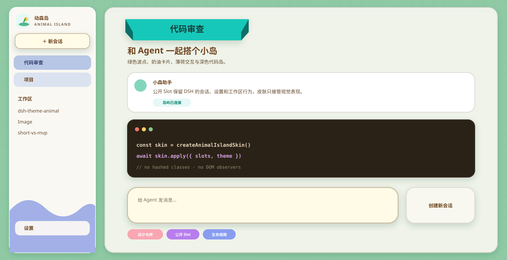
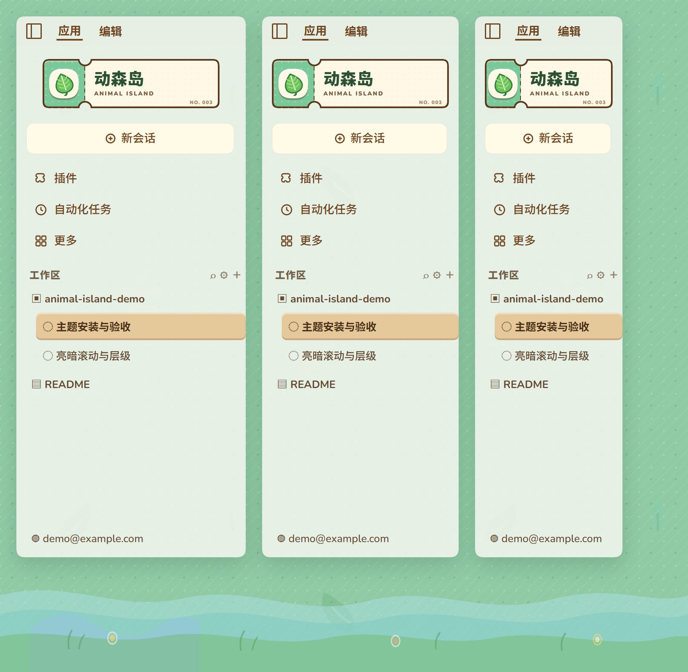
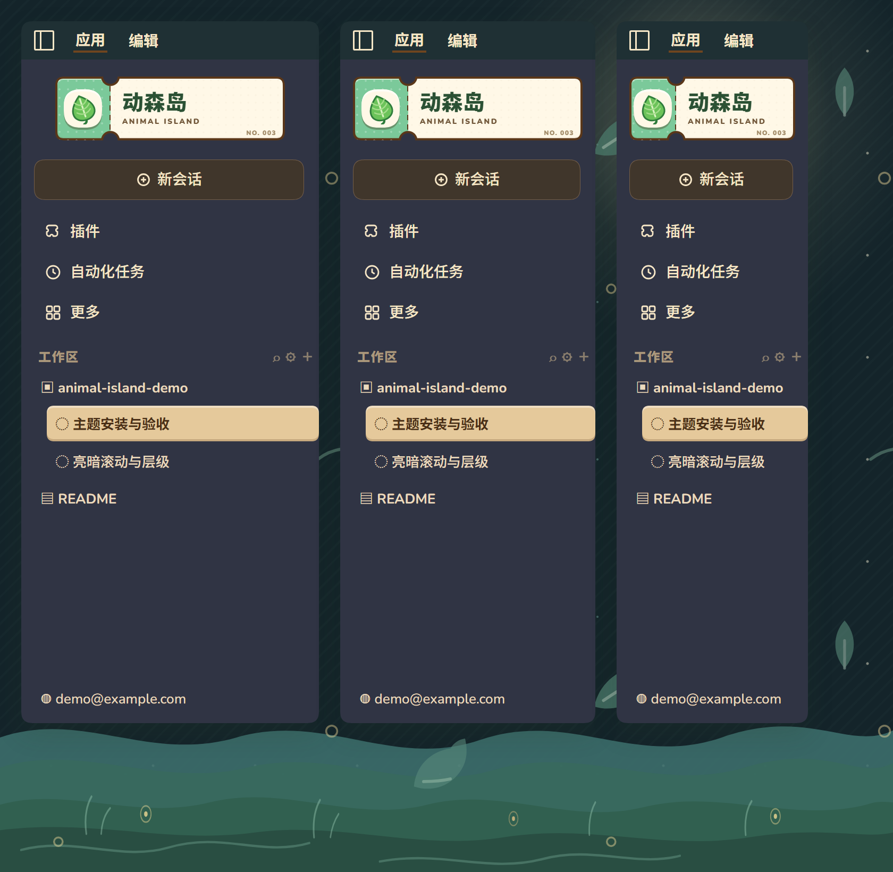

# DSH Animal Island UI Theme

[简体中文](README.md)

[Product site](https://shirolin.github.io/dsh-theme-animal-island-ui/) · [30-second promo film](https://shirolin.github.io/dsh-theme-animal-island-ui/#film)

[](https://github.com/Shirolin/dsh-theme-animal-island-ui/actions/workflows/check.yml)
[](https://github.com/Shirolin/dsh-theme-animal-island-ui/releases)
[](LICENSE)

An Animal Island–inspired community theme plugin for DeepSeek Harness (Web and Windows Desktop). It layers DSH ThemeRuntime tokens, plugin-owned CSS/artwork, and public DSH slots—bringing warm paper surfaces, wooden badges, and a boarding-pass masthead to DSH while keeping native sessions, settings, workspaces, composer, and shortcuts intact.



<details>
<summary>Real DSH DOM fixture: light and dark sidebar</summary>

| Light | Dark |
| --- | --- |
|  |  |

</details>

## Highlights

- **Day & Night islands**: Polka-dot turf, water ripples, and floating leaves by day; a dedicated starry night island with warm paper surfaces, deep-teal sidebar, moonlight, and fireflies by night;
- **Public slots & native shell**: Boarding-pass brand masthead (`216×60`), hero card, bubble composer, paper-grain dialogs, and 2px inset mint focus rings that never clip inside scroll views;
- **In-app appearance tab**: Built into `Settings → Plugins` with three presets (`0.22` / `0.40` / `0.55`), a `0.15–0.60` opacity slider, and a live layered canvas preview;
- **Self-contained assets**: Bundled Nunito Latin fonts and original SVG artwork with zero runtime network requests;
- **Verified compatibility**: Contract tests for 118 ThemeRuntime tokens, public slots, ARIA/data hooks, and headless Chrome DOM fixtures.

The visual language is inspired by Animal Island UI. No upstream code, logo, illustration, font, or
complete stylesheet is copied. See [THIRD_PARTY_NOTICES.md](THIRD_PARTY_NOTICES.md).

## Compatibility

The development baseline is DSH `0.1.5-rc.3`. The theme deliberately fails soft when a public
ThemeRuntime capability is unavailable. Compatibility details and the reviewed seam list live in
[docs/compatibility.md](docs/compatibility.md).

## Install

1. Download the latest `.tgz` and `SHA256SUMS` from
   [GitHub Releases](https://github.com/Shirolin/dsh-theme-animal-island-ui/releases).
2. Verify the tarball against `SHA256SUMS`.
3. Install it into the target DSH profile:

```sh
cd <profile-directory>
pnpm add file:<download-directory>/dsh-theme-animal-island-ui-<version>.tgz
```

Restart DSH completely after installation. Web and Desktop use different profiles; Desktop setup is
documented in [docs/desktop.md](docs/desktop.md).

## Development

Requirements: Node.js 22.13 or newer and pnpm 11.1.2.

```sh
pnpm install
pnpm run format:check
pnpm run lint
pnpm run check
```

`pnpm run check` covers type checking, build, contract tests, and the pinned DSH compatibility
check. Visual fixtures use real DSH CSS and DOM shapes:

```sh
pnpm run fixture sidebar-masthead
pnpm run fixture boot-loading --desktop
```

## Documentation

The detailed technical documentation is currently written in Chinese:

- [Design language and style boundaries](docs/design.md)
- [DSH compatibility contract](docs/compatibility.md)
- [Desktop installation, debugging, and rollback](docs/desktop.md)
- [Web and Desktop differences](docs/web-vs-desktop.md)
- [Changelog](CHANGELOG.md)

## Contributing and security

See [CONTRIBUTING.md](CONTRIBUTING.md) and [CODE_OF_CONDUCT.md](CODE_OF_CONDUCT.md). Report security
issues privately through [SECURITY.md](SECURITY.md), not in a public issue.

## License

MIT. Bundled Nunito font files remain under SIL OFL 1.1 as recorded in
[THIRD_PARTY_NOTICES.md](THIRD_PARTY_NOTICES.md).
