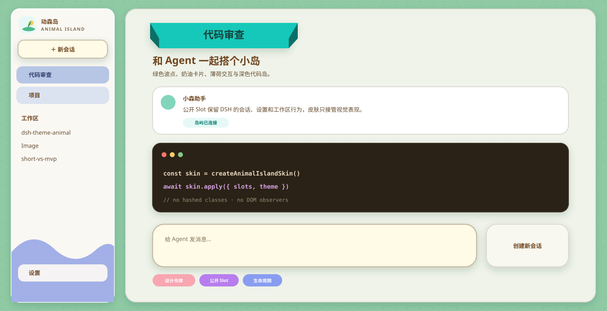

# DSH Animal Island UI Theme

`Animal Island UI`（一动森）是一个面向 DeepSeek Harness Web GUI 的高还原社区 skin plugin。0.2.7 在 ThemeRuntime 色彩层之上增加了插件自有 CSS、原创资源和 DSH 公开 Slot，目标是接近 [animal-island-ui](https://guokaigdg.github.io/animal-island-ui/#/skill) 的岛屿游戏界面，同时保持 DSH 会话、设置、工作区和 composer 的原生行为。



## v0.2.7 视觉范围

- 绿色双层波点画布；
- 奶油白侧栏、蓝紫底部波浪与原创岛标；
- 薄荷标题绶带、暖棕文字和蓝紫 active；
- 白色/奶油色卡片、圆润 composer、pill 输入与文字按钮；
- 奶油色 3D 主按钮和 hover/active 按压反馈；
- Light / Dark 均可读的深棕色代码块与 Shiki 配色；
- 内嵌 Nunito Latin 字体，中文回退 Noto Sans SC / 苹方 / 微软雅黑。

设计图是方向性 specimen；真实 DSH 截图是最终验收依据。

## 稳定边界

插件只使用：

1. `ctx.theme.overrideTokens()` 管理 Light / Dark / System token；
2. DSH `dsh.client` Module Loader；
3. `ctx.slots` 的公开品牌和 hero Slot，同时保留 DSH 官方 Sidebar 根组件；
4. 插件自己创建并清理的 `<style>`、根属性和原创资源；
5. 少量有版本测试的语义 `data-*` CSS 增强。

不使用 DSH hash class、私有 `lib/*`、React 私有符号、DOM 扫描、MutationObserver、合成点击或焦点劫持。DSH 升级后缺失的能力只会安全降级，不会阻塞 GUI。

## 架构

```text
ThemeRuntime token layer
        +
plugin-owned CSS / fonts / original SVG
        +
official Sidebar + public Brand/Hero slots
```

主题仍叠加在 DSH Light / Dark / System 之上，不新增持久化外观设置。

## 开发

```sh
pnpm install
pnpm run typecheck
pnpm run build
pnpm test
pnpm run check:compat
```

统一门禁：

```sh
pnpm run check
```

构建使用 esbuild 生成适配 DSH `factory(require)` 的客户端 bundle，React 由 DSH 平台模块表提供，Nunito WOFF2 与原创 SVG 在构建时内嵌。

## 安装到 DSH profile

```sh
pnpm install
pnpm pack
```

`prepack` 会自动重建 `lib`。0.2.7 的规范产物为：

```text
artifacts/release-v0.2.7/dsh-theme-animal-island-ui-0.2.7.tgz
```

将 `.tgz` 加入目标 `web` profile 后，完整重启 DSH Web 并刷新页面。当前 profile 应只启用一个主题层；Ember Dusk 可保留安装但禁用用于回滚。

## 兼容性

默认检查仓库锁定的 DSH `0.1.5-rc.3`：

```sh
pnpm run check:compat
```

检查其他 DSH 安装时显式指定 ThemeRuntime 包目录：

```sh
node scripts/check-compat.mjs --dsh-package "C:\path\to\@deepseek-ai\dsh-client-ui-theme"
```

也可设置 `DSH_THEME_PACKAGE`。检查覆盖 ThemeRuntime disposer、全部 token、服务/Provider 顺序、公开 Slot 类型、DOM fallback、Observer 和私有导入。详见 [docs/compatibility.md](docs/compatibility.md) 与 [docs/design.md](docs/design.md)。

## 许可证与来源

- 本插件代码：MIT，见 `LICENSE`。
- Nunito：SIL OFL 1.1，见 `licenses/Nunito-OFL.txt`。
- Animal Island UI：只参考视觉语言；没有复制其代码、组件、Logo、字体、插画或完整 CSS。参考基线与许可证见 `THIRD_PARTY_NOTICES.md`。
