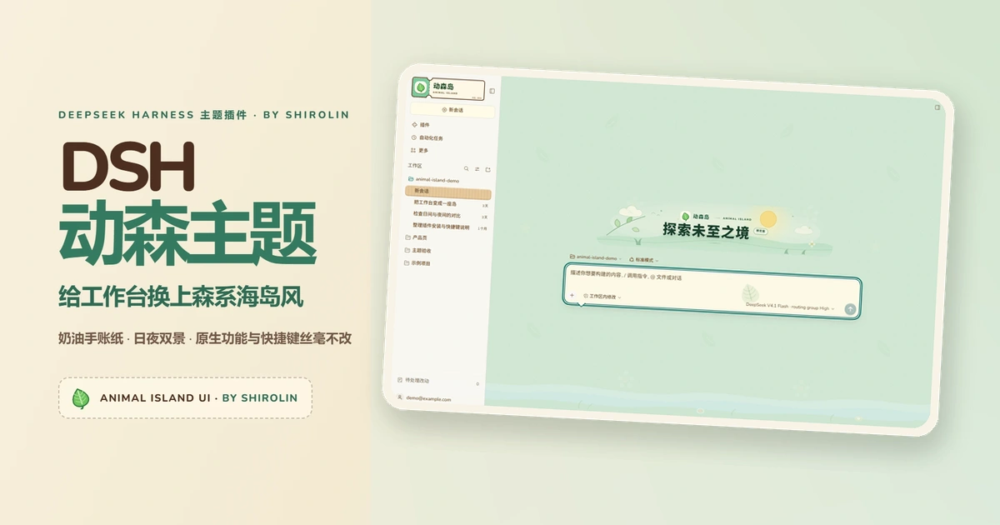
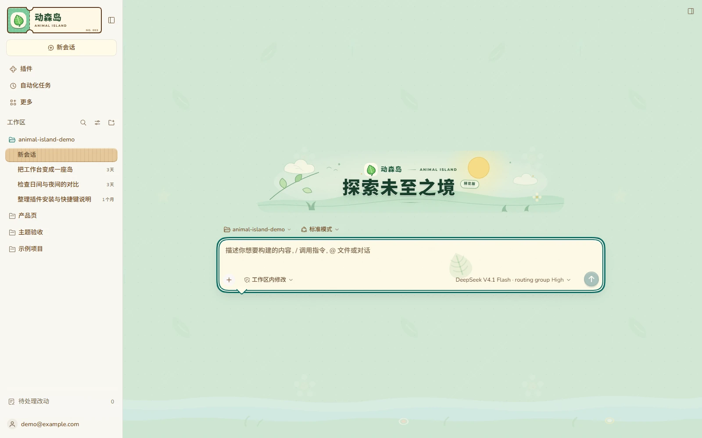
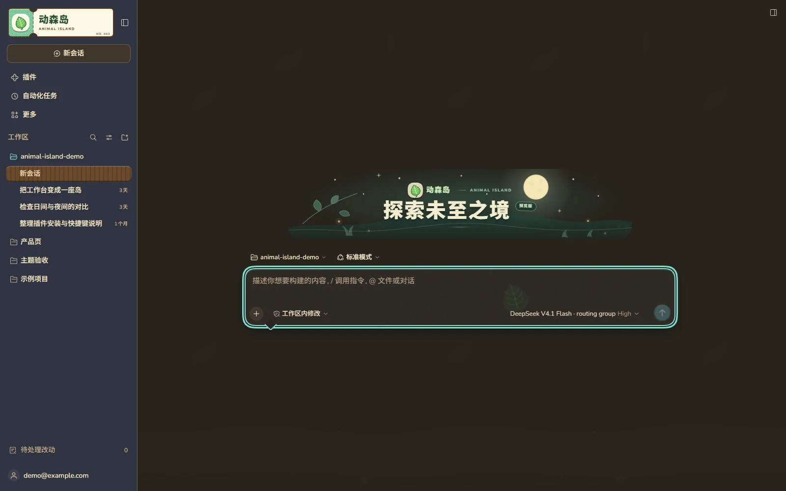
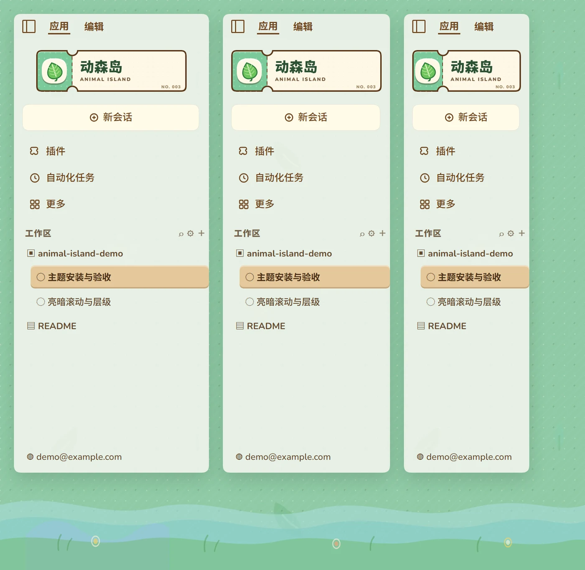
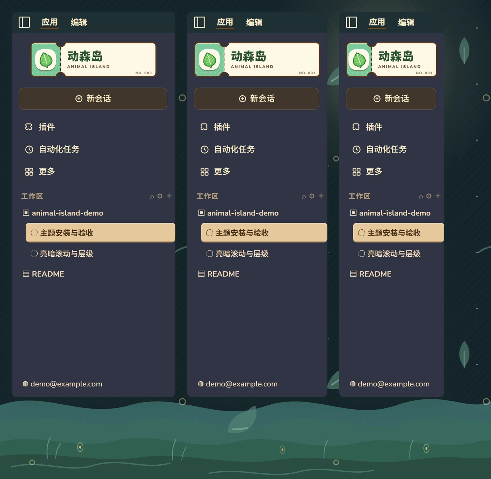

# DSH 动森主题 · Animal Island UI

[English](README.en.md) · [官方宣传站](https://shirolin.github.io/dsh-theme-animal-island-ui/) · [30 秒实机短片](https://shirolin.github.io/dsh-theme-animal-island-ui/#film) · 作者：[Shirolin](https://github.com/Shirolin)

[](https://github.com/Shirolin/dsh-theme-animal-island-ui/actions/workflows/check.yml)
[](https://github.com/Shirolin/dsh-theme-animal-island-ui/releases)
[](LICENSE)

`Animal Island UI` 是为 DeepSeek Harness（Web 与 Windows 桌面端）打造的动森风主题插件。它将渡岛船票品牌区、奶油手账纸、木牌选中态与夜岛星空带入工作台，还原 [animal-island-ui](https://guokaigdg.github.io/animal-island-ui/#/skill) 的手账质感，同时完整保留 DSH 的所有原生交互、布局与快捷键。

> [!NOTE]
> 本项目为开源社区插件，与 DeepSeek 官方无隶属、授权或背书关系。主题仅作用于 DSH 公开的 ThemeRuntime Token 与 Slot 接缝，不劫持私有组件，DSH 升级后可安全降级。

---

## 界面预览



<details>
<summary>展开查看：日间 / 夜间工作台与侧栏实拍（真实 DSH DOM 夹具）</summary>

| 日间模式 (Light) | 夜间模式 (Dark) |
| --- | --- |
|  |  |
|  |  |

</details>

---

## 核心特性

- 🏝️ **昼夜双岛画布**
  - **日间**：双层波点草坪、水纹底浪与漂浮叶片，搭配高可读性的奶油白纸面。
  - **夜间**：独立绘制的星空、月光与萤火虫微光，深青侧栏配暖棕内容纸面，久看不刺眼。
- 🎫 **手账质感与微交互**
  - **渡岛船票品牌区**：`216×60` 奶油纸面 + 薄荷票根 + 虚线撕口，替代单调顶栏。
  - **木牌与气泡容器**：木质标题绶带、木牌选中态、对话气泡输入框与纸纹弹窗。
  - **触感反馈**：3D 奶油主按钮按压回弹、输入气泡呼吸发光、2px 内嵌薄荷键盘焦点环（滚动容器内不裁切）。
- 🎛️ **应用内外观设置**
  - 在「**设置 → 插件 → 动森外观**」中提供「纸白 / 均衡 / 海岛」三档预设与 `0.15–0.60` 画布浓度滑杆，支持面板内实时分层预览。
  - 支持独立开关**插画装饰**、**纸纹质感**与**界面字体**（内嵌 Nunito Latin 字体或系统原生字体栈），配置按客户端独立保存在本地。
- 🛡️ **零侵入与离线自包含**
  - 字体（Nunito WOFF2）与原创 SVG 插画均在构建时内嵌，运行时零外部网络请求。
  - 严格遵循 DSH 公开契约（覆盖 118 项 ThemeRuntime Token），不触碰私有模块或 DOM Observer，不改写其他插件的自身布局。

---

## 快速安装

### 1. 下载发行包

前往 [GitHub Releases](https://github.com/Shirolin/dsh-theme-animal-island-ui/releases) 下载最新版本的 `.tgz` 安装包与 `SHA256SUMS` 校验文件。

### 2. 安装到 DSH Web Profile

进入你的 DSH profile 目录，将依赖指向下载的 `.tgz` 包（确保后续 `pnpm install` 不会回退版本）：

```sh
cd <DSH_Profile_目录>
pnpm add file:<下载目录>/dsh-theme-animal-island-ui-<version>.tgz
```

安装完成后，**完整重启 DSH Web 服务并刷新浏览器页面**。建议同一 profile 下仅启用一个主题插件。

### 3. Windows 桌面端（Electron）

DSH 桌面客户端使用独立的 `desktop` profile，且需通过客户端内置的 Electron Node 运行时安装。完整安装、HMR 热更新与回滚命令请参阅 **[桌面客户端指南 (docs/desktop.md)](docs/desktop.md)**。

如果是克隆本仓库进行本地构建体验，可直接运行一键同步脚本（同时写入 `web` 与 `desktop` profile）：

```sh
pnpm install
pnpm run install:local
```

---

## 开发与验证

需要 **Node.js ≥ 22.13** 与 **pnpm 11.1.2**。

```sh
pnpm install
pnpm run build          # 构建客户端 bundle（lib/）
pnpm run check          # 统一门禁：站点检查 + 类型 + 构建 + 契约测试 + DSH 兼容性检查
pnpm run format         # Biome 代码格式化
pnpm run lint           # Biome 静态检查
```

**视觉与离屏夹具验收**：

```sh
pnpm run fixture sidebar-masthead            # 使用真实 DSH CSS 渲染指定夹具（产物位于 artifacts/smoke/）
pnpm run fixture boot-loading --desktop      # 自动解包桌面端 app.asar 并渲染桌面夹具
pnpm run check:visual                        # 运行侧栏船票真实 DOM 视觉门禁
```

作为 NPM 包复用色板或 Token 派生逻辑时，可从独立子路径导入：

```ts
import { ANIMAL_ISLAND_PALETTES } from 'dsh-theme-animal-island-ui/palette'
import { buildTokenOverrides, contrastRatio } from 'dsh-theme-animal-island-ui/tokens'
```

---

## 文档索引

详细的设计规范、兼容契约与排障记录均保存在仓库文档中：

- 🎨 **[设计语言与样式边界 (docs/design.md)](docs/design.md)**：色板规范、明暗派生、组件形状及不可越界的样式禁区
- 🔌 **[DSH 兼容性契约 (docs/compatibility.md)](docs/compatibility.md)**：已审阅的公开 Slot、`data-*` / ARIA 接缝清单与离屏验收夹具说明
- 🖥️ **[桌面客户端指南 (docs/desktop.md)](docs/desktop.md)**：Electron profile 隔离机制、安装/回滚、CDP/DWM 截图与远程调试
- ⚖️ **[Web 与桌面端差异清单 (docs/web-vs-desktop.md)](docs/web-vs-desktop.md)**：跨平台标题栏、折叠侧栏与历史适配问题归档
- 🔍 **[侧栏会话列表空白排查 (docs/session-list-blank.md)](docs/session-list-blank.md)**：DSH 侧槽位错误边界与快照问题的诊断路径
- 📊 **[社区主题设置项调研 (docs/research/theme-settings-survey.md)](docs/research/theme-settings-survey.md)**：主题配置面设计与取舍依据
- 📝 **[版本变更日志 (CHANGELOG.md)](CHANGELOG.md)**：各版本功能演进与修复记录

---

## 贡献与反馈

非常欢迎提交 Issue 或 Pull Request！

- 提交代码前请阅读 **[贡献指南 (CONTRIBUTING.md)](CONTRIBUTING.md)**，了解接缝契约登记、离屏夹具验证与发版流程。
- 参与社区交流请遵守 **[行为准则 (CODE_OF_CONDUCT.md)](CODE_OF_CONDUCT.md)**。
- 如发现安全隐患，请按 **[安全策略 (SECURITY.md)](SECURITY.md)** 通过私有渠道报告，勿在公开 Issue 中披露。

---

## 许可证与致谢

本项目基于 **[MIT License](LICENSE)** 开源发布。

- **视觉致谢**：设计灵感源自 [guokaigdg/animal-island-ui](https://github.com/guokaigdg/animal-island-ui)（MIT）。本插件未复制其源代码、组件、Logo、字体、插画或完整样式表，所有 DSH Token 映射、React 品牌组件与 SVG 资源均为独立实现。
- **字体许可**：内嵌的 Nunito 字体遵循 [SIL Open Font License 1.1](licenses/Nunito-OFL.txt)。
- 完整第三方声明请参阅 **[THIRD_PARTY_NOTICES.md](THIRD_PARTY_NOTICES.md)**。

---

## 赞助与支持

如果你觉得 `Animal Island UI` 让你的日常工作台更加舒适愉悦，欢迎支持开发者的持续创作与维护：

- ❤️ **爱发电 (Afdian)**：[https://ifdian.net/a/shirolin](https://ifdian.net/a/shirolin)
- ☕ **Ko-fi**：[https://ko-fi.com/shirolin](https://ko-fi.com/shirolin)
- ⭐ 也欢迎为本仓库点亮一颗 **Star**，或体验作者的另一个开源项目 **[S1er](https://github.com/Shirolin/s1er)**！
